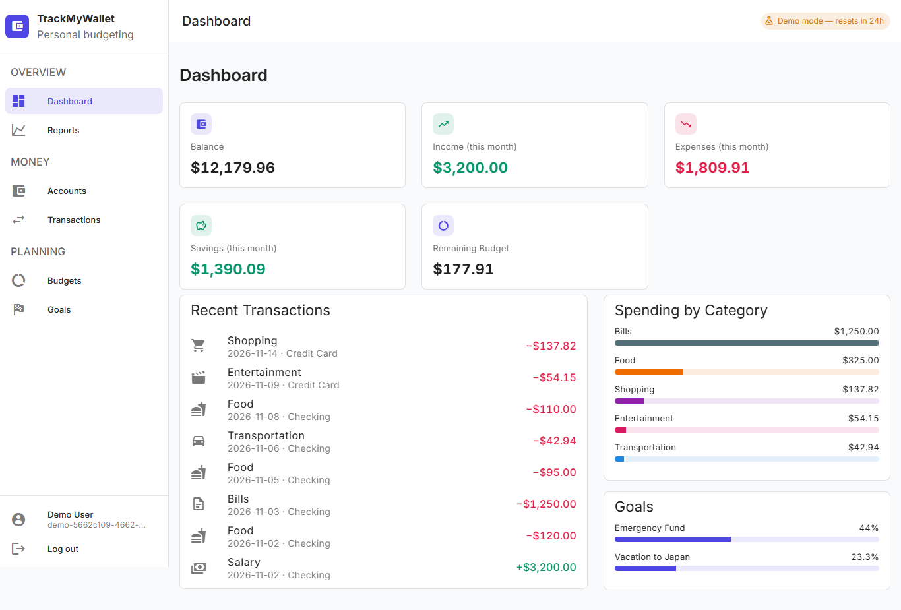
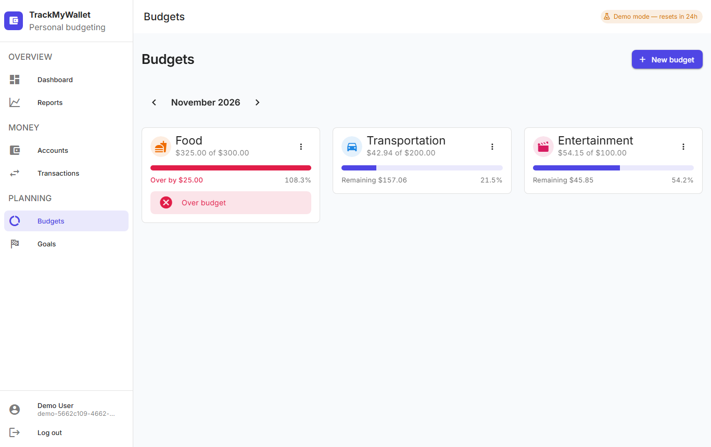
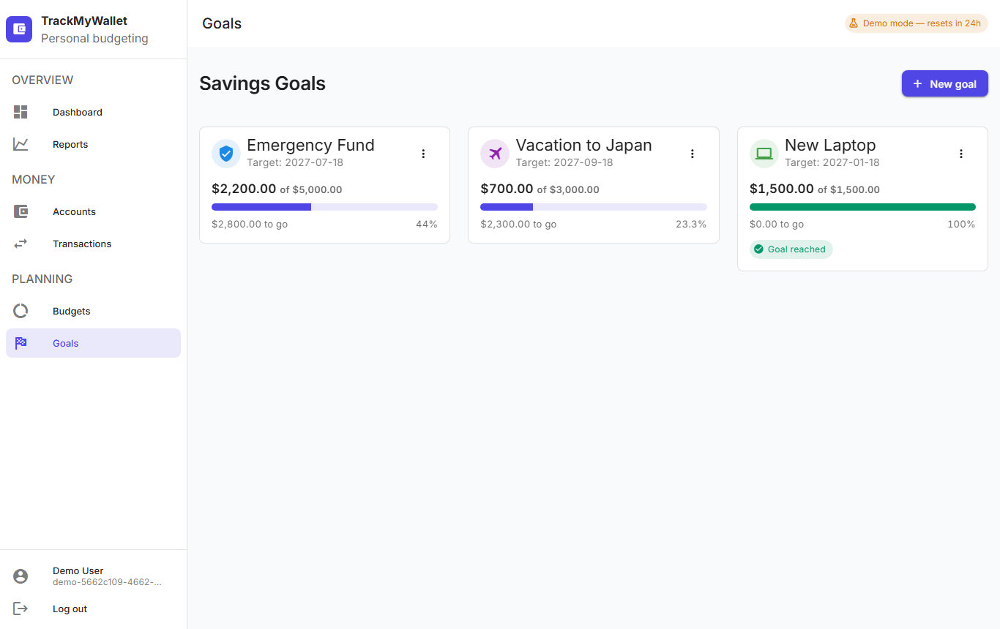
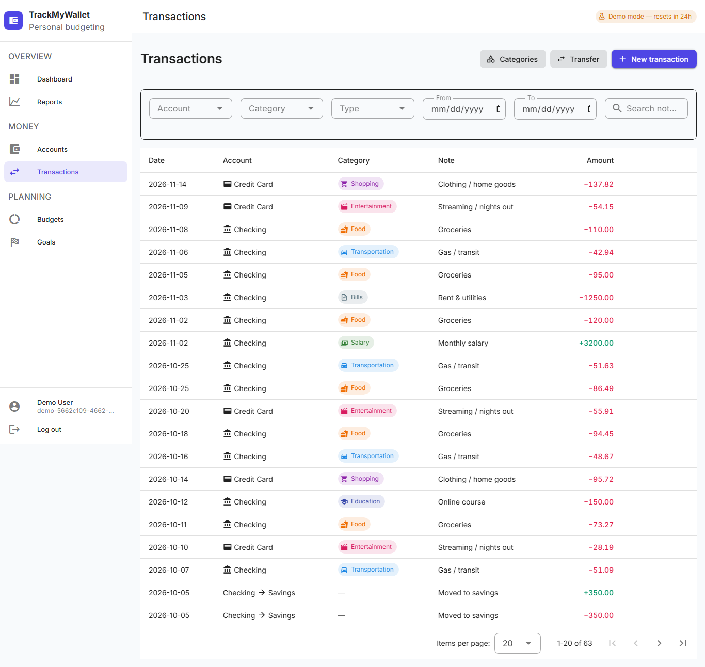
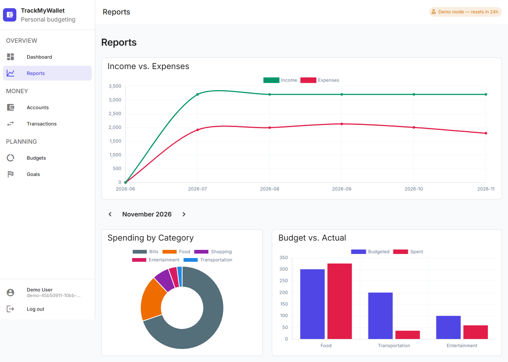

# TrackMyWallet — API

The Laravel API behind [TrackMyWallet](https://trackmywallet.org), a personal finance app for tracking accounts, transactions, budgets, and savings goals. This repo is the backend half; the SPA that consumes it lives in [`personal-wallet-frontend`](https://github.com/nadimelchammaii-hash/personal-wallet-frontend).

**Live demo: [trackmywallet.org](https://trackmywallet.org)** — click **Try the demo** on the login page for an instant, pre-populated account. No sign-up required.



## What it does

TrackMyWallet is a full personal-budgeting app:

- **Accounts** — cash, bank, credit card, and savings accounts, each with a running balance kept in sync by every transaction, transfer, and reversal.
- **Transactions** — income and expenses by category, transfers between your own accounts (as linked debit/credit legs), filtering by account/category/type/date, free-text search.
- **Categories** — a shared set of defaults (Food, Bills, Transportation, …) plus user-defined custom categories.
- **Budgets** — a monthly spending cap per category, with progress and an over-budget flag computed from actual spend.
- **Savings goals** — a target amount and date, funded by logged contributions, auto-completing once the target is reached.
- **Reports** — income vs. expenses over time, spending by category, and budget vs. actual, all driven by real aggregate queries (no client-side computation).
- **Auth** — standard email/password registration, login, logout, and password reset, plus a one-click demo login (see below).

## The live demo

The **Try the demo** button on the login page calls `POST /api/v1/demo-login`, which:

1. Creates a brand-new, fully isolated user (not a shared seeded account — every visitor gets their own).
2. Seeds it with ~5 months of realistic history: a monthly salary, rent/bills, groceries, transport, entertainment, a few one-off irregular expenses, transfers into savings, and goal contributions spread out over time — tuned so the current month's budgets show a believable mix of over/under.
3. Logs the new user in exactly like a real login (same Sanctum session).

Demo accounts expire 24 hours after creation and can't change their profile or password. Cleanup is lazy rather than cron-driven: each `demo-login` call sweeps any accounts past their expiry before creating a new one, which keeps the feature self-contained with no scheduler required.

## Stack

- **PHP 8.3+**, **Laravel 13**
- **Laravel Sanctum** — SPA (cookie + CSRF) authentication, not token-based; the API and SPA are treated as same-origin in production
- **MySQL 8**
- **Pest** for testing (91 feature tests)
- **Docker Compose** for local dev; **Docker + Caddy** in production (see [Deployment](#deployment))

## How it works

- **Decoupled from the frontend.** This is a pure JSON API (`routes/api.php`, versioned under `/api/v1`). It has no views of its own beyond the default Laravel welcome page. CORS and Sanctum's stateful-domain config are what let the SPA (on its own subdomain/port in dev) authenticate via cookies.
- **Thin controllers, real service objects.** Business logic that has to stay consistent — like keeping an account's `current_balance` correct across creates/edits/deletes of transactions and transfers — lives in `app/Services/TransactionService.php`, not scattered across controllers.
- **Authorization via policies.** Every mutable resource (`Account`, `Transaction`, `Budget`, `SavingsGoal`, `Category`) has a policy gating access to its owner only.
- **Form Requests validate, Resources shape the response.** Every endpoint has a dedicated `FormRequest` under `app/Http/Requests/Api/V1/...` and a matching `JsonResource` — no ad hoc validation or array-building in controllers.
- **The demo feature reuses production code paths.** `App\Services\DemoDataSeeder` seeds transactions through the same `TransactionService` a real request would use, so balances, budgets, and reports are exactly as consistent for a demo account as for a real one.

## Screenshots

| | |
|---|---|
|  |  |
|  |  |

## Getting started

The easiest way to run the full stack (this API + the frontend + MySQL + phpMyAdmin) is `docker-compose.yml` in this repo — it also builds the frontend from a sibling `../personal-wallet-frontend` checkout, so clone both repos side by side first:

```bash
docker compose up
```

To run just this API standalone instead:

```bash
composer install
cp .env.example .env
php artisan key:generate
# point DB_* in .env at a MySQL instance, then:
php artisan migrate --seed   # seeds the shared default categories
php artisan serve
```

### Tests

```bash
php artisan test
```

91 Pest feature tests cover auth, every CRUD resource, transfers, the dashboard/report aggregations, and the demo-login flow (including its 24h expiry sweep and rate limiting).

## Deployment

Production runs as three Docker containers behind Caddy: `mysql`, a `backend` container built from `Dockerfile.prod` (PHP-FPM, `composer install --no-dev`), and a `frontend` container whose Caddy instance serves the built SPA and reverse-proxies `/api/*` and `/sanctum/*` straight to this API's PHP-FPM socket — so the browser only ever talks to one origin. See `docker-compose.prod.yml` and `Dockerfile.prod`.
